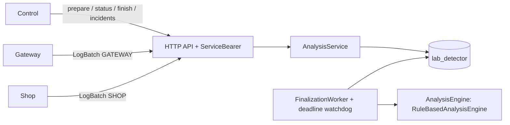
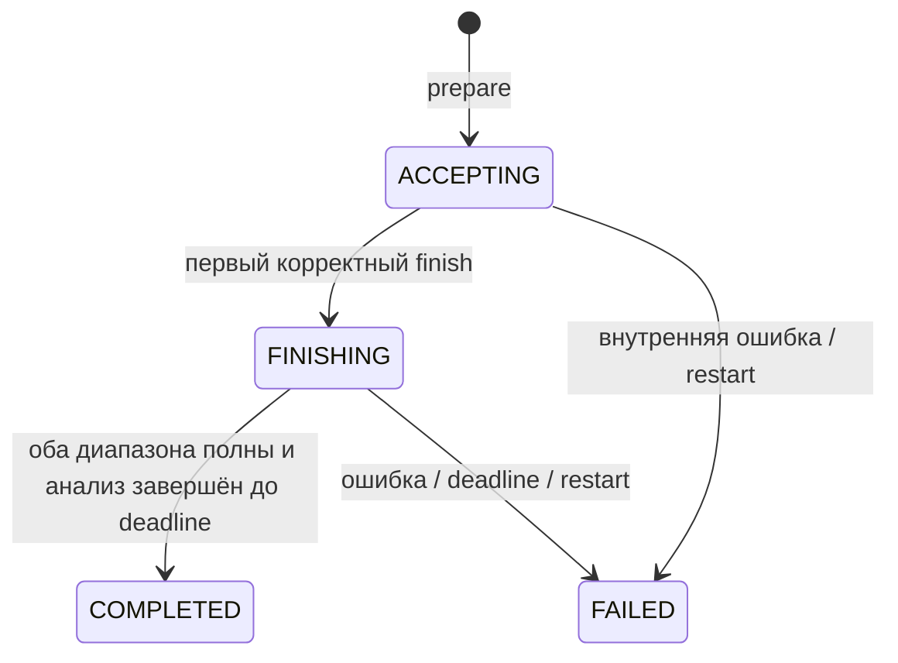

# ADR-0002. Приём логов и завершение анализа Detector

16 ноября 2026 года. Статус: принят, транспорт и протокол реализованы.

## Контекст и объём

Detector получает access-логи Gateway и Shop напрямую по HTTP, хранит их и публикует
текущие инциденты по мере анализа поступающих логов. Итоговый результат фиксируется
после получения полных последовательностей обоих producers.
Источники требований:

- [Detector API](../../contracts/detector-api.openapi.yaml) и
  [схемы](../../contracts/schemas/detector.yaml);
- [AccessLog и LogBatch](../../contracts/schemas/logs.yaml);
- [требования к логированию и доставка](../04-events-and-detection.md);
- [семантика приёма пачек и finish](../../contracts/semantics.md#приём-пачек-и-finish).

В объём входят prepare/status, приём пачек, идемпотентность, finish с границами,
ожидание полноты, публикация и чтение incidents. Правила обнаружения относятся к
S2-20. HTTP API, миграции, подключение окружения в Compose и интеграционные тесты
реализованы. На момент принятия ADR на границе анализа использовался явный
`EmptyAnalysisEngine`. Сейчас его заменяет `RuleBasedAnalysisEngine` с фиксированными
правилами входа CS-01–CS-05; [условия правил](../04-events-and-detection.md#реализованные-правила-входа).

## Компоненты

Используем существующее приложение `apps/lab-detector`, Spring MVC, JDBC и отдельную
БД `lab_detector` в существующем PostgreSQL 17. Один процесс Detector обслуживает
состояние, изолированное по runId. HTTP-запросы выполняют короткие транзакции;
анализ работает в отдельном executor. Для HTTP-доставки в целевом Compose добавляется
внутренняя сеть `lab-ingest` с Control, Gateway, обоими Shop и Detector; порт Detector
на хост не публикуется. Подключение к PostgreSQL остаётся в `lab-data` с собственной
DB-ролью Detector.

Пакеты внутри `lab.detector`:

| Пакет | Ответственность |
|---|---|
| `http` | Реализация сгенерированного `lab.contracts.detector.api.DefaultApi`, преобразование ошибок в Problem |
| `security` | Проверка ServiceBearer и привязка токена к роли |
| `analysis` | Подготовка run, статус, атомарный ingest и сравнение повторов, фиксация finish и переходы состояний |
| `storage` | JDBC repositories и транзакции; физическая схема принадлежит Detector |
| `finalization` | Проверка полноты, дедлайны, фоновый анализ и публикация результата |
| `engine` | Анализ согласованного снимка наблюдений, правила CS-01–CS-05 и объединение evidence в incidents |

Общие DTO, строгий JSON и проверка схем переиспользуются из `libs/lab-contracts`.
Detector не читает бизнес-БД, сценарии, labels и эталон Control.

## Аутентификация и конфигурация

Три независимых opaque Bearer-токена читаются из окружения. Operator Bearer Control
и пользовательский JWT Shop для этих операций не подходят.

| Переменная | Кто предъявляет | Разрешённые операции |
|---|---|---|
| `LAB_DETECTOR_CONTROL_TOKEN` | Control | PUT/GET `/runs/{runId}`, PUT `finish`, GET `incidents` |
| `LAB_DETECTOR_GATEWAY_TOKEN` | Gateway | POST `log-batches` только с `producer=GATEWAY` |
| `LAB_DETECTOR_SHOP_TOKEN` | Оба экземпляра Shop | POST `log-batches` только с `producer=SHOP` |

Все пути имеют префикс `/internal/v1`. Токен определяет разрешённого producer;
поле в теле сверяется с ролью, а не переписывается молча. Producer не может
создавать run, вызывать finish, читать статус или incidents. Control не пишет пачки.
Неизвестный/отсутствующий токен даёт 401, известный токен без требуемого права — 403.
Права проверяются до обращения к run, включая попытки повторной доставки.
При старте отсутствующий, пустой, содержащий пробелы или совпадающий с другим токен
запрещает запуск. Секреты сравниваются без раннего выхода и не попадают в логи.
`/health` доступен без токена и не раскрывает конфигурацию.

Detector хранит значения этих входящих токенов для проверки; credentials для вызова
Control/Shop, их Operator Bearer, JWT и пароли бизнес-БД ему не передаются.
В Compose каждый producer получает только свой токен, Control — только управляющий,
Detector — все три значения для проверки. Совместный токен двух Shop соответствует
единому producer SHOP; runId разделяет прогоны, активные прогоны не перекрываются.

Это глобальные служебные роли Detector. Control имеет доступ ко всем runs;
Gateway/Shop могут доставлять своего producer в любой run, подготовленный Control.
Пользовательских владельцев runs и отдельных токенов для каждого run нет.
Изоляция данных обеспечивается предикатами run_id в SQL, а доступ к операциям —
проверкой роли и producer. Знание UUID не предоставляет дополнительных прав.

ServiceAccessFilter хранит токены в памяти процесса и сравнивает их с Authorization;
контроллер получает только имя роли. Заголовок не переносится в payload или состояние
run, сообщения ошибок не содержат значений токенов. В текущем Compose внутренний HTTP
не использует TLS. Доступ к окружению контейнера, памяти JVM и Docker daemon позволяет
прочитать секреты; internal-сеть и private-поля не являются шифрованием.

В `.env.example` также резервируются `LAB_DETECTOR_DB_PASSWORD` для `detector_app`
и `LAB_DETECTOR_MIGRATION_PASSWORD` для отдельного `detector_migrator`.
Эти переменные подключены в Compose; создание локальных секретов поддерживает
`scripts/start.sh`.

## Хранение и миграции

Выбираем PostgreSQL: он уже есть в стенде и даёт транзакционное сохранение всей пачки,
уникальность ключей и блокировки для согласования ingest/finish. Отдельная БД
изолирует владение схемой и роли от Control/Shop. Логи не хранятся в общих томах
producers или в Loki; архивный `docs/data/legacy-lab/lab-detector-access.sql`
не используется как новая схема.

Внутренняя схема `detector`:

| Таблица | Основные поля и ограничения |
|---|---|
| `analysis_runs` | `run_id uuid PK`, `created_instance_id uuid`, `state`, `created_at`, `finish_request jsonb NULL`, `deadline_at timestamptz NULL`, `completed_at NULL`, `error varchar(500) NULL` |
| `producer_progress` | PK `(run_id, producer)`, FK на run; `received_count`, `max_sequence`, `last_sequence NULL`; ровно две строки GATEWAY/SHOP на run |
| `access_logs` | PK `(run_id, producer, sequence)`, FK на progress; `payload jsonb`, `request_id uuid`, `event_time timestamptz`, `event_nanos`, `received_at` |
| `incidents` | PK `(run_id, incident_id)`, FK на run; `detected_at timestamptz`, `detected_nanos`, nullable `family`, `request_ids uuid[]`, `description varchar(1000)` |
| `live_incidents` | Такая же форма строки для изменяемого текущего снимка; отдельные права SELECT/INSERT/DELETE |

Миграция V3 добавляет в analysis_runs input_revision, processed_revision и analyzed_at,
таблицу live_incidents и индексы. Одна пачка с новыми записями увеличивает input_revision
в той же транзакции, что и логи; processed_revision отмечает опубликованный снимок.
Изменения действующих V1/V2 не требуются. Неизменяемые incidents и access_logs сохраняют
прежние права без UPDATE/DELETE.

CHECK ограничивает state четырьмя контрактными значениями, producer двумя значениями,
sequence диапазоном 1..100000, счётчик и last_sequence диапазоном 0..100000.
Начальный count/max равен 0; last_sequence отсутствует до finish. Фиксация обоих
last_sequence, finish_request и deadline выполняется одной транзакцией. Ниже
`N_G` и `N_S` обозначают сохранённые last_sequence Gateway и Shop.

В `payload` сохраняется JSON-представление прошедшего проверку DTO `AccessLog`
со всеми обязательными null-полями. Типизированные request_id/event_time служат
для выборок; они извлекаются из того же DTO.
Индексы: `(run_id, request_id)` для observed/evidence,
`(run_id, event_time, event_nanos, producer, sequence)` для анализа,
`(run_id, detected_at, detected_nanos, incident_id)` для страниц incidents и частичный индекс
по deadline_at для FINISHING. PK логов уже покрывает выборки последовательностей.
Времена сохраняются с усечением до микросекунд и отдельным исходным nano-полем;
это сохраняет точный порядок и значение Incident.detectedAt при большей точности
исходного timestamp. Deadline берётся из точного finish_request.

Набор observedRequestIds вычисляется как DISTINCT request_id обоих producers по
неизменяемым логам завершённого run с устойчивым порядком UUID. Отдельная копия
набора в analysis_runs не нужна. До COMPLETED API возвращает null; после него —
массив, в том числе пустой. Более 100000 уникальных ID означает FAILED, без усечения.

Миграции:

1. Bootstrap PostgreSQL создаёт `lab_detector`, роли `detector_migrator` и
   `detector_app`. Это инфраструктурная операция; runtime-процесс не создаёт роли/БД.
2. Detector упаковывает `db/detector/migrations` в JAR и запускает Flyway с
   `classpath:db/detector/migrations` и default schema `detector`. Отдельный
   migration datasource использует detector_migrator с DDL-правами только своей БД.
3. `V1__detector_storage.sql` создаёт таблицы, CHECK/FK, индексы и DML grants.
   Рабочий datasource использует detector_app: SELECT/INSERT логов и incidents,
   SELECT/INSERT/UPDATE runs и progress. У него нет DDL, DELETE и UPDATE логов/incidents;
   migration-роль не наследуется. Право CREATE схемы public для PUBLIC отзывается.
4. Следующие изменения идут отдельными `V2__...sql`, `V3__...sql`; применённые
   миграции не редактируются. На существующем volume bootstrap новой БД/ролей
   выполняется явно, без удаления данных Control/Shop.

Readiness открывается после миграций и стартовой обработки старых runs. До сохранения
отчёта данные не удаляются; автоматическая retention и API удаления в этот объём
не входят. Диск и объём очередей ограничиваются конфигурацией; переполнение является
ошибкой опыта, а не поводом молча удалить логи.

## Жизненный цикл и HTTP

В API нет отдельного ANALYZING: во время вычисления результата состояние FINISHING.
COMPLETED/FAILED терминальны; повтор prepare их не сбрасывает.

| Операция | Поведение |
|---|---|
| PUT `/runs/{runId}` | Атомарно создаёт ACCEPTING и две строки progress; 201. Повтор возвращает существующий статус с 200 |
| GET `/runs/{runId}` | 200 с instanceId, state, error и observedRequestIds; неизвестный run — 404 |
| POST `log-batches` | 204 только после commit всей пачки; означает сохранение, не завершение анализа |
| PUT `finish` | Фиксирует неизменяемые границы и deadline; 202 с текущим состоянием, включая идентичные повторы |
| GET `incidents` | ACCEPTING/FINISHING — текущий снимок; COMPLETED — итоговый; FAILED — 409. `items` и `total`, порядок detectedAt, incidentId; limit 1..100, offset 0..100000 |

Для всех операций неизвестный run даёт 404, кроме создающего PUT. Ошибки HTTP имеют
общий `application/problem+json` с допустимыми Problem.code/status и техническим
requestId. Ошибки JSON/схемы — 400, превышение размера — 413, конфликты протокола — 409,
недоступность хранилища — 503. Ошибки ответа не должны раскрывать payload или токены.

## Транзакции и идемпотентность пачки

Каждая мутация существующего run сначала выполняет
`SELECT ... FROM detector.analysis_runs WHERE run_id = ? FOR UPDATE`.
Одного уровня READ COMMITTED с этой общей блокировкой достаточно: ingest, finish,
публикация и watchdog получают последовательный порядок в пределах run. Другие
runs не блокируются. Конкурентный prepare использует INSERT ON CONFLICT DO NOTHING
с последующим чтением, поэтому не создаёт две пары progress.

Алгоритм ingest:

1. Проверить токен, форму JSON, producer и лимиты до мутации. До 100 записей,
   64 KiB на запись, 8 MiB на пачку; sequence 1..100000. Пачка не обязана быть
   отсортированной или непрерывной. Использовать общую строгую валидацию JSON,
   включая запрет повторяющихся ключей, неизвестных полей и неявных приведений типов.
2. Сгруппировать DTO entries по sequence. Идентичные повторы внутри пачки свернуть;
   различное содержимое одного sequence даёт 409 для всей пачки.
3. В транзакции заблокировать run и прочитать существующие записи всех ключей пачки.
   Восстановить сохранённые записи в DTO AccessLog и сравнить все поля через
   `AccessLog.equals`, включая status, bytes и request_time. Совпавшие записи пропустить;
   любое различие даёт 409. Не заменять старую запись новой через upsert.
4. Проверить все новые ключи по состоянию: ACCEPTING разрешает новые записи;
   FINISHING — только sequence ≤ last_sequence своего producer;
   COMPLETED/FAILED — ни одного нового ключа. Нарушение отклоняет всю пачку.
   При терминальном состоянии пачка из одних идентичных повторов всё ещё даёт 204.
5. Вставить новые записи и увеличить count/max только на действительно вставленные
   ключи в той же транзакции. Commit, затем 204. При любой ошибке вставки откатить
   все новые записи и прогресс пачки.

Равенство содержимого определяется значениями DTO `AccessLog` после десериализации
штатным `ContractJsonHttpMessageConverter` из lab-contracts. Он выполняет чтение тела,
проверку схемы и лимитов, а также создание DTO. В Detector нет своего конвертера,
захвата тела или повторного разбора HTTP-запроса. Сохранённые payload читаются в
AccessLog обычным отображением данных из БД; повторная валидация входа при этом не нужна.

Порядок JSON-полей, пробелы и различия представления, дающие равные DTO, несущественны.
Например, `1` и `1.00`, регистр букв UUID и UTC-время с `Z`/`+00:00` не создают конфликт.
request_time имеет контрактный тип double: разные исходные JSON-числа, преобразованные
в одинаковый Double, считаются одинаковым содержимым. Произвольная точность исходного
числового литерала не сохраняется. Detector не добавляет нормализацию полей DTO;
во всех случаях используется штатный AccessLog.equals.

req_hash описывает бизнес-запрос и не заменяет сравнение всех полей AccessLog.
requestId связывает два наблюдения запроса, но не заменяет ключ доставки
`(runId, producer, sequence)`.

Потеря HTTP-ответа после commit безопасна: producer повторяет те же ключи/содержимое
и получает 204. Новые sequence для технического повтора доставки не назначаются.
Повторы не увеличивают прогресс и не запускают повторный анализ.

## Finish, полнота и публикация

Первый finish в ACCEPTING под блокировкой run:

1. Проверяет оба N (0..100000) и deadlineAt по схеме. Если любой N ниже уже
   сохранённого max_sequence своего producer — 409 без изменения состояния/границ.
2. Сохраняет оба N, исходный finish_request и deadlineAt, переводит run в FINISHING.
   Поздние пачки внутри границ остаются допустимы.
3. Возвращает 202 после commit, не ожидая доставки или выполнения анализа в HTTP.

Повтор сначала сравнивается с уже зафиксированными `(N_G, N_S, deadlineAt)`.
Идентичный возвращает текущее состояние, изменённый даёт 409 без изменений, в том
числе после COMPLETED/FAILED. Deadline сравнивается как момент времени с исходной
точностью; исходный finish_request нужен, чтобы округление timestamptz не скрыло
изменение deadline. Если run уже FAILED и finish ещё не фиксировался, новый finish
не возобновляет run и даёт 409. Deadline в прошлом не продлевается: корректный
первый finish фиксируется и приводит к FAILED при проверке дедлайна.

Полнота проверяется отдельно для каждого producer: `received_count = N` при
`max_sequence ≤ N`. PK исключает дубликаты, sequence положителен и все записи
ограничены сверху N, поэтому это доказывает наличие каждого номера 1..N. При N=0
полон только пустой поток. `{1, 3}` при N=3 остаётся неполным до получения 2;
ни max_sequence, ни присутствие последнего номера сами по себе не завершают run.

FinalizationWorker каждые 500 мс находит изменившиеся ACCEPTING/FINISHING runs
и FINISHING с полными диапазонами для окончательного прохода. БД является источником
работы; корректность не зависит от доставки внутрипроцессного уведомления после
commit. Отдельный ограниченный executor выполняет анализ, watchdog независимо
проверяет дедлайны. Для одного run одновременно выполняется не более одной задачи.
DB lease, fencing и несколько экземпляров Detector не входят в MVP.

Worker читает состояние run, input_revision, observed requestIds и логи в одной
read-only REPEATABLE READ транзакции без row lock. Новые логи могут приниматься
параллельно. AnalysisEngine пересчитывает полный текущий снимок. Логи подаются в порядке
`time, producer, sequence`; при совпадении времени фиксируется GATEWAY перед SHOP.
Для точного порядка используется время AccessLog из payload, если его точность выше
точности индекса event_time. Объединение наблюдений выполняется по requestId.
Поздно доставленные меньшие sequence меняют input_revision и вызывают пересчёт.
Неизменившиеся runs повторно не анализируются, кроме окончательного прохода после finish.

Текущий снимок заменяется в live_incidents транзакционно под row lock run.
IncidentIdentityResolver сохраняет ID/время первого обнаружения по общей evidence,
при слиянии выбирает наиболее раннюю существующую идентичность. processed_revision
равна ревизии рассчитанного снимка; новые данные остаются основанием следующего расчёта.
Старый результат не может заменить уже обработанную более новую ревизию.

Публикация происходит одной транзакцией под блокировкой run: повторно проверить
FINISHING, полноту и точный deadline, проверить лимиты результата и связь evidence
с наблюдавшимися requestIds, вставить все incidents и установить COMPLETED.
До commit итогового результата API возвращает текущий снимок; транзакция также
очищает live_incidents. После commit логи, границы и итоговый результат неизменяемы.
observedRequestIds и все страницы incidents читаются из этого зафиксированного набора.

Если диапазоны не заполнены или анализ не завершён к deadline, watchdog переводит
run в FAILED с безопасным error. Просроченный worker не может опубликовать результат:
он повторно проверяет состояние и время перед публикацией. Ошибка анализа/лимитов
также даёт FAILED без публикации частичных incidents. Переход FAILED фиксируется
отдельной транзакцией после отката неудачной операции; отклонённая конфликтная
пачка или finish сами по себе не меняют состояние run. Control трактует сбой,
нарушение протокола или отсутствие COMPLETED как INCONCLUSIVE своего прогона.

## Граница с S2-20 и сбои

`AnalysisEngine` получает только runId и согласованный снимок сохранённых access-наблюдений
и возвращает Incident. API, хранение и finish не зависят от конкретных правил. Для проверки
транспортного контура допустима явная пустая реализация, возвращающая `[]` после
проверки полноты; она не подтверждает качество обнаружения. В текущей реализации
event-time окна и incidents для CS-01–CS-05 вычисляет `RuleBasedAnalysisEngine`.
Загрузка внешнего ruleset и его валидация при prepare остаются отдельными задачами.

instanceId — UUID процесса, генерируемый один раз при старте и возвращаемый во всех
AnalysisStatus. В БД отдельно сохраняется created_instance_id. При старте прежние
ACCEPTING/FINISHING переводятся в FAILED без продолжения анализа; логи сохраняются,
терминальные runs не меняются. Control видит смену instanceId и не продолжает старый
эксперимент. Сохранение данных в PostgreSQL не означает поддержку resume/failover.

Если БД недоступна, переход FAILED может быть невозможен: HTTP возвращает 503,
readiness закрывается, Control фиксирует INCONCLUSIVE. Нельзя подтверждать пачку 204
до commit или публиковать пустой результат вместо потерянных логов.

## Проверки

Интеграционные тесты JDBC выполняются с PostgreSQL 17/Testcontainers:

- конкурентные prepare одного run, повторный prepare терминального run и 404;
- матрица прав трёх токенов, чужой producer, пустые/совпавшие токены при старте;
- запрет чтения/управления известным run для producers, запрет идентичного повтора
  чужого producer, поддельные заголовки роли и повторяющийся Authorization;
- отсутствие Bearer-токенов из заголовков в ответах, сохранённых данных run и логах
  при штатной обработке, 400/401/403/409 и ошибке engine; env/configprops не опубликованы;
- изоляция логов, прогресса, observedRequestIds и incidents двух runs при одинаковых
  sequence/incidentId, запрет evidence из другого run;
- SQL-строки в access-логах и описаниях incidents сохраняются как данные; SQL-фрагменты
  в UUID, producer, числовых полях и пагинации отклоняются до записи;
- повтор сохранённой пачки и повтор внутри пачки; конфликт одного элемента
  откатывает остальные вставки и прогресс, включая искусственный сбой записи;
- потеря ответа после commit, разные JSON-порядки полей и конфликт разных DTO
  при одинаковом req_hash;
- одинаковые DTO из разных числовых литералов, UUID/UTC-представлений и знаков нуля:
  повторы внутри пачки, после сохранения и после COMPLETED; отличающееся значение
  double даёт 409 и откат всей пачки;
- гонки ingest/finish и ingest/публикация, N ниже принятого sequence,
  изменённый/идентичный finish, включая терминальные состояния;
- N=0 обоих/одного producer, `{1,3}` без 2, поздняя 2, два независимых producer,
  превышение границы и только идентичные повторы после COMPLETED/FAILED;
- deadline при пропуске и при долгом engine, запрет поздней публикации;
- null observedRequestIds до завершения, объединение ID producers после него,
  лимит 100000 без усечения, текущие incidents до finish, 409 в FAILED и стабильные итоговые страницы;
- restart с новым instanceId, отсутствие resume, раздельные DB-роли и миграция
  новой/существующей БД без изменения данных Control/Shop.

## Последствия и альтернативы

В памяти удобно ждать диапазоны, но нельзя подтвердить транзакционное хранение;
общий файл JSONL потребовал бы отдельно реализовать индексы, блокировки и атомарность
пачки. PostgreSQL позволяет сохранить эти гарантии в существующей инфраструктуре.
Блокировка одной строки сериализует ingest одного run; для MVP с одним экспериментом
это принимается. Увеличение числа параллельных runs и пропускной способности потребует
повторного измерения, но не меняет контракт producers.

Финальный проход проще обработки событий на лету и даёт детерминированный вход при
неупорядоченной доставке. Цена — задержка анализа после finish и необходимость
учесть его длительность в deadline. Kafka, общий лог-сборщик и восстановление после
падения в этот объём не входят.
