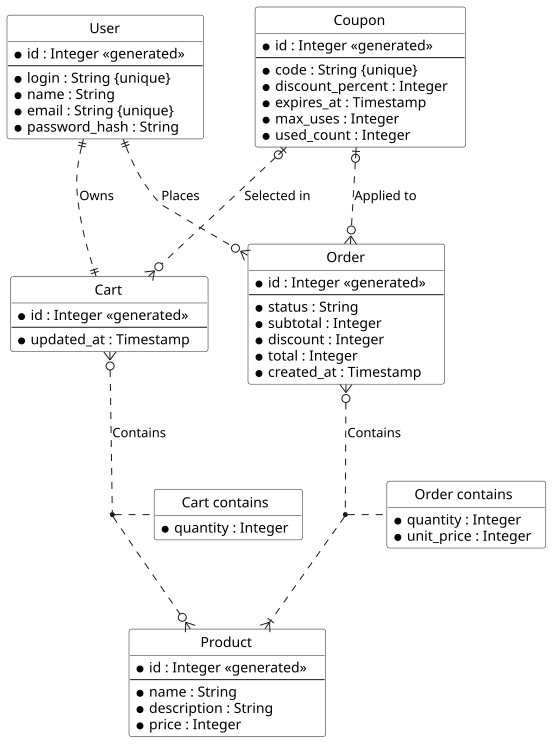

# Модель данных API магазина

Описание данных демо-магазина, на котором воспроизводятся abuse-сценарии.  
Источники: [Код ER](er_logic.puml) (логическая модель) и [Код DBML](physical-schema.dbml) (физическая модель).

Одна схема используется в двух версиях: `vulnerable` и `protected`, в независимых базах. Версии различаются защитой, а
не набором данных (см. [раздел 5](#5-отличие-версий-api)).

## 1. Соглашения

| Тема           | Правило                                                                                       |
|:---------------|-----------------------------------------------------------------------------------------------|
| Деньги         | Целые числа в рублях.                                                                         |
| Скидка         | `floor(subtotal * discount_percent / 100)`, всегда в рублях                                   |
| Время          | `timestamptz`, UTC; срок купона проверяется серверным временем                                |
| Идентификаторы | Целочисленные автоинкрементные. Они предсказуемы, поэтому на них опираются сценарии BOLA/IDOR |
| Пароли         | Только хеш. В API и логи не попадает                                                          |

## 2. Сущности

### users – пользователи и их профиль

| Поле            | Тип                  | Описание                       |
|:----------------|----------------------|--------------------------------|
| `id`            | integer, PK          | Идентификатор                  |
| `login`         | varchar(32), unique  | Логин                          |
| `name`          | varchar(100)         | Имя                            |
| `email`         | varchar(256), unique | Почта (персональные данные)    |
| `password_hash` | varchar(100)         | Хеш пароля, наружу не отдаётся |

### products – каталог

| Поле          | Тип          | Описание             |
|:--------------|--------------|----------------------|
| `id`          | integer, PK  | Идентификатор        |
| `name`        | varchar(120) | Название             |
| `description` | text         | Описание             |
| `price`       | integer      | Цена в рублях, `> 0` |

### coupons – купоны

| Поле               | Тип                 | Описание                          |
|:-------------------|---------------------|-----------------------------------|
| `id`               | integer, PK         | Идентификатор                     |
| `code`             | varchar(32), unique | Код, который вводит покупатель    |
| `discount_percent` | integer             | Размер скидки, 1–100%             |
| `expires_at`       | timestamptz         | Срок действия                     |
| `max_uses`         | integer             | Общий лимит использований, `> 0`  |
| `used_count`       | integer, default 0  | Сколько раз купон уже использован |

### carts – корзины

| Поле         | Тип                   | Описание                               |
|:-------------|-----------------------|----------------------------------------|
| `id`         | integer, PK           | Идентификатор                          |
| `user_id`    | integer, FK, unique   | Владелец; одна корзина на пользователя |
| `coupon_id`  | integer, FK, nullable | Выбранный купон (не больше одного)     |
| `updated_at` | timestamptz           | Последнее изменение                    |

### cart_items — позиции корзины (связь «Cart contains»)

| Поле         | Тип             | Описание               |
|:-------------|-----------------|------------------------|
| `cart_id`    | integer, PK, FK | Корзина                |
| `product_id` | integer, PK, FK | Товар                  |
| `quantity`   | integer         | Количество, от 1 до 99 |

Первичный ключ составной: `(cart_id, product_id)`.

### orders – заказы

| Поле         | Тип                             | Описание                                             |
|:-------------|---------------------------------|------------------------------------------------------|
| `id`         | integer, PK                     | Идентификатор                                        |
| `owner_id`   | integer, FK                     | Пользователь, оформивший заказ                       |
| `coupon_id`  | integer, FK, nullable           | Применённый купон (не больше одного)                 |
| `status`     | order_status, default `CREATED` | `CREATED` или `CANCELLED`                            |
| `subtotal`   | integer                         | Сумма до скидки: `quantity * unit_price` по позициям |
| `discount`   | integer, default 0              | Скидка по купону                                     |
| `total`      | integer                         | Итог: `subtotal − discount`                          |
| `created_at` | timestamptz                     | Время оформления                                     |

### order_items — позиции заказа (связь «Order contains»)

| Поле         | Тип             | Описание                  |
|--------------|-----------------|---------------------------|
| `order_id`   | integer, PK, FK | Заказ                     |
| `product_id` | integer, PK, FK | Товар                     |
| `quantity`   | integer         | Количество, `> 0`         |
| `unit_price` | integer         | Цена на момент оформления |

Первичный ключ составной: `(order_id, product_id)`.

## 3. Связи

| Связь           | Кратность                 | Смысл                                      |
|-----------------|---------------------------|--------------------------------------------|
| User – Cart     | 1 : 1                     | У пользователя ровно одна корзина          |
| User – Order    | 1 : 0..N                  | Пользователь оформляет заказы              |
| Cart – Product  | N : M через `cart_items`  | В корзине 0..N товаров                     |
| Order – Product | N : M через `order_items` | В заказе 1..N товаров                      |
| Coupon – Cart   | 0..1 : 0..N               | В корзине не больше одного купона          |
| Coupon – Order  | 0..1 : 0..N               | К заказу применено не больше одного купона |

## 4. Инварианты

Инварианты определяют, что считается успешной атакой: сценарий проверяет, нарушен ли хотя бы один из них.

| Область         | Инвариант                                                                                                                           |
|-----------------|-------------------------------------------------------------------------------------------------------------------------------------|
| Доступ          | Корзину, позиции корзины, заказ и профиль читает и изменяет только владелец                                                         |
| Цена            | Цена берётся только из `products.price`; значение от клиента её не заменяет                                                         |
| Количество      | Целое число > 0 (в корзине ещё ≤ 99)                                                                                                |
| Заказ           | Содержит хотя бы одну позицию; `unit_price` равна цене каталога на момент оформления                                                |
| Суммы           | `subtotal = Σ quantity * unit_price`; `total = subtotal − discount`; `0 ≤ discount ≤ subtotal`; `total ≥ 0`                         |
| Скидка          | Совпадает с `floor(subtotal × discount_percent / 100)` или равна 0 без купона                                                       |
| Купон           | На момент заказа не просрочен; `0 ≤ used_count ≤ max_uses` при любом числе одновременных запросов                                   |
| Учёт купона     | `used_count` равен числу заказов с этим купоном; успешный заказ с купоном увеличивает его ровно на 1, неуспешный не расходует лимит |
| Идемпотентность | Повтор одной операции создаёт не более одного заказа и учитывает купон не более одного раза                                         |

Нарушение инвариантов проверяет отдельный read-only запрос поверх этих данных. Защитный слой его не использует.

## 5. Отличие версий API

| Угроза               | vulnerable                              | protected                                           |
|----------------------|-----------------------------------------|-----------------------------------------------------|
| BOLA/IDOR            | Выборка по `id` без владельца           | Выборка по `id` и владельцу; чужое даёт 403         |
| Injection            | Поиск собирается конкатенацией строки   | Параметризованный запрос и валидация                |
| Количество ≤ 0       | Не проверяется ни в API, ни в БД        | Схема + `CHECK` в БД                                |
| Подмена цены         | Сумма берётся от клиента                | Пересчёт на сервере                                 |
| Лимит купона         | Проверка и обновление раздельно (гонка) | Условный `UPDATE` + `CHECK (used_count ≤ max_uses)` |
| Согласованность сумм | Нет ограничений                         | `CHECK` на `subtotal`, `discount`, `total`          |
| Повтор заказа        | Нет защиты                              | Ключ идемпотентности, уникальный на пользователя    |

Защитные ограничения БД применяются только в protected: иначе общий `CHECK` незаметно "починил" бы уязвимую версию.
